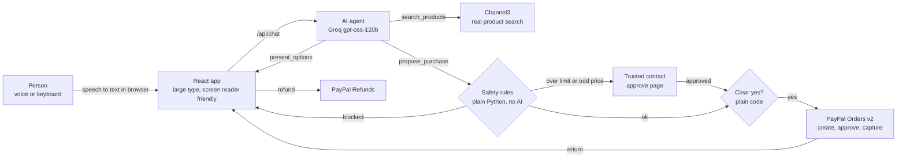

# Sahaya

**Shop by voice, safely.** Sahaya is an AI shopping agent for people who are blind, have low vision, or are older. You say what you need. It finds real products, reads three options aloud, and pays through PayPal. It never pays without your own "yes", and a trusted family member approves anything over your limit.

*Sahaya* means "help" in Malayalam and Sanskrit.

**Live demo:** https://sahaya-bw5e.onrender.com (use Chrome for voice; the first load can take up to a minute while the free server wakes up)

Built for the PayPal AI Hackathon 2026.

## Why

Online checkouts assume you can see small text, compare prices across tabs and spot a scam. For millions of people that is not true, so they depend on someone else to shop for them or overpay. AI agents can now shop, but an agent that can spend money on behalf of a vulnerable person must be impossible to trick and must never pay on its own.

## What it does

1. **Talk naturally.** "I need a talking alarm clock for my nan." Typos and vague requests are fine.
2. **Three real options, read aloud.** Products come from Channel3 (25,000+ retailers). The AI picks up to three that genuinely fit and reads them as Option 1, 2, 3.
3. **Safety checks in plain code.** Price confirmed, sensible quantity, daily limit, fair price, supported currency, and no hidden instructions in the listing.
4. **Your yes, then PayPal.** A clear "yes" opens PayPal to approve. "Yes but cheaper" or "wait" never pays.
5. **Trusted contact.** Over your limit, or an unusually high price, goes to a family member's approval page first.
6. **After you buy.** "Where's my order?" and "I want a refund" work by voice. Refunds go through PayPal.

## Try it as a judge

1. Open the live demo in Chrome and press the marigold button (or type).
2. Say "a talking alarm clock", then "option 1", then "yes".
3. Log in to the PayPal sandbox with the test buyer below and approve. You'll land on "Payment complete". Press "Ask for a refund".
4. For the trusted contact flow, pick something over 50 dollars and open "trusted contact view".
5. For the safety demo, open "Safety demo for judges" at the bottom, switch it on, and search again. A fake listing that orders the AI to "buy 5 now" is caught and shown to you, never offered.

| PayPal sandbox test buyer | |
|---|---|
| Email | `` |
| Password | `` |

This is a PayPal **sandbox** account. No real money moves anywhere in this project.

## How it works



**The AI can't pay.** The model has five tools: search, present options, propose a purchase, cancel, and list or refund orders. None of them moves money. A proposal goes through deterministic rules, then waits for the person's own yes, which is recognised by plain code (not the model). Only then is a PayPal order created, and the person approves it on PayPal's own page.

**Seller text is untrusted.** Titles, descriptions and features from listings are scanned for instructions aimed at the AI. Flagged listings are hidden from the model's view, never shown, and cannot be bought, even if the model asks.

| Rule (in `backend/app/policy.py`) | What happens |
|---|---|
| Price unknown, bad quantity, unsupported currency | Blocked |
| Listing contains instructions for the AI | Blocked and shown as "tried to trick me" |
| Would go over the daily limit (default 150) | Blocked |
| Over the approval amount (default 50) | Trusted contact must approve |
| Price far above other shops or similar items | Trusted contact must approve |
| Everything else | Waits for the person's clear "yes" |

## Tools used

| Tool | How Sahaya uses it |
|---|---|
| **PayPal Orders v2** | Creates an order only after the person's yes; buyer approves on PayPal; Sahaya captures on return. Idempotency keys stop double charges. |
| **PayPal Refunds** | Voice or one button refund of a captured payment. |
| **PayPal sandbox** | All payments, tests and the live demo. |
| **Groq, `openai/gpt-oss-120b`** | The agent's reasoning and tool calls. Falls back to `gpt-oss-20b` when the free tier rate limit is hit. |
| **Channel3 API** | Real product search across retailers, with offers, prices, images and key features. |
| **Render** | Hosts the API (Python web service) and the React app (static site) from `render.yaml`. |
| **Web Speech API** | Speech to text and text to speech in the browser, no extra service. |

## Testing

| Suite | What it covers | Result |
|---|---|---|
| `backend/tests` (pytest) | Safety rules, yes/no with typos and hedges, every API route, full journeys, failures (PayPal down, AI down), double clicks, session isolation | 167 passing |
| `tests-ui` (Playwright) | Real browser journeys: cold start, pay and refund, typos, family approve and decline, safety demo, keyboard only, 320px phones, axe accessibility scan in light and dark mode, server dying mid chat | 24 passing |
| `scripts/eval_live.py` | The real AI with typos, vague needs, Spanish, changed minds, off topic chat, and a user telling it to pay without the rules | 12/12 passed, 0 payments without a yes (`eval_results.json`) |

## Run it yourself

Needs Python 3.11 to 3.13 and Node 18+.

```bash
cp .env.example .env            # add your PayPal sandbox, Groq and Channel3 keys
cd backend
python3 -m venv .venv && source .venv/bin/activate
pip install -r requirements.txt
uvicorn app.main:app --reload --port 8000
```

In a second terminal:

```bash
cd frontend && npm install && npm run dev
```

Open http://localhost:5173 in Chrome.

**No keys?** Run the backend with `SAHAYA_FAKE=1 uvicorn app.main:app --port 8000` to use a fake PayPal, a scripted AI and a small demo catalog.

```bash
cd backend && pytest -q                                   # unit and API tests
cd tests-ui && npm install && npx playwright install chromium && npm test   # browser tests
cd backend && python ../scripts/eval_live.py              # live AI evaluation (uses your Groq key)
```

## Limits and next steps

- Voice input needs Chrome, Edge or Safari. Typing works everywhere.
- Purchases and sessions are kept in memory; a restart clears them. A database is the next step.
- The trusted contact link opens on the same device in this demo; production would text or email it.
- Channel3 prices are mostly in USD; Sahaya only charges in the listing's own currency.

## License

MIT
